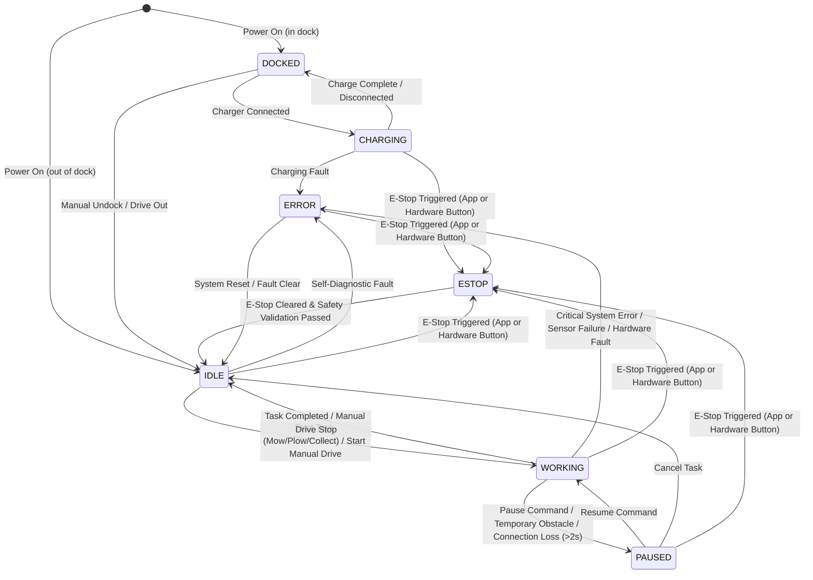
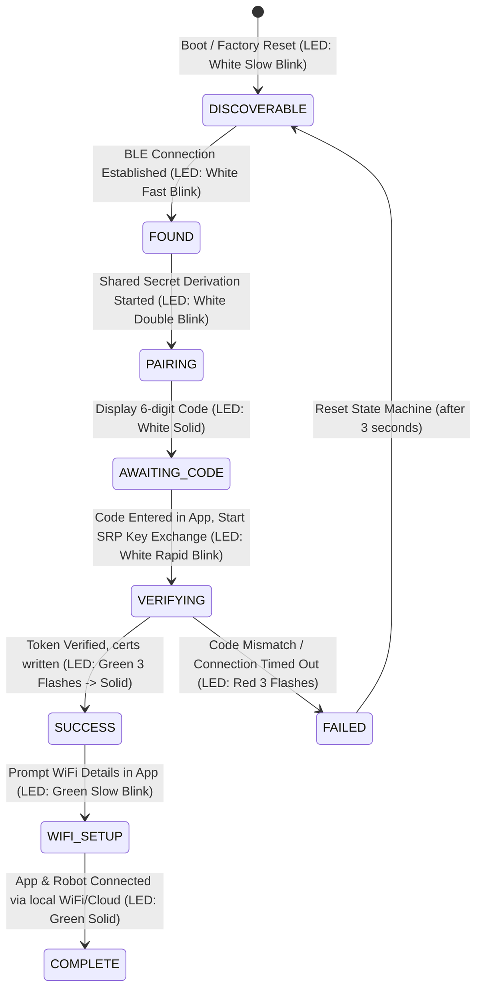
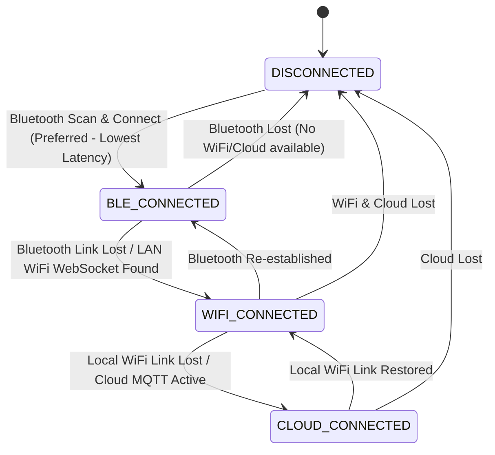
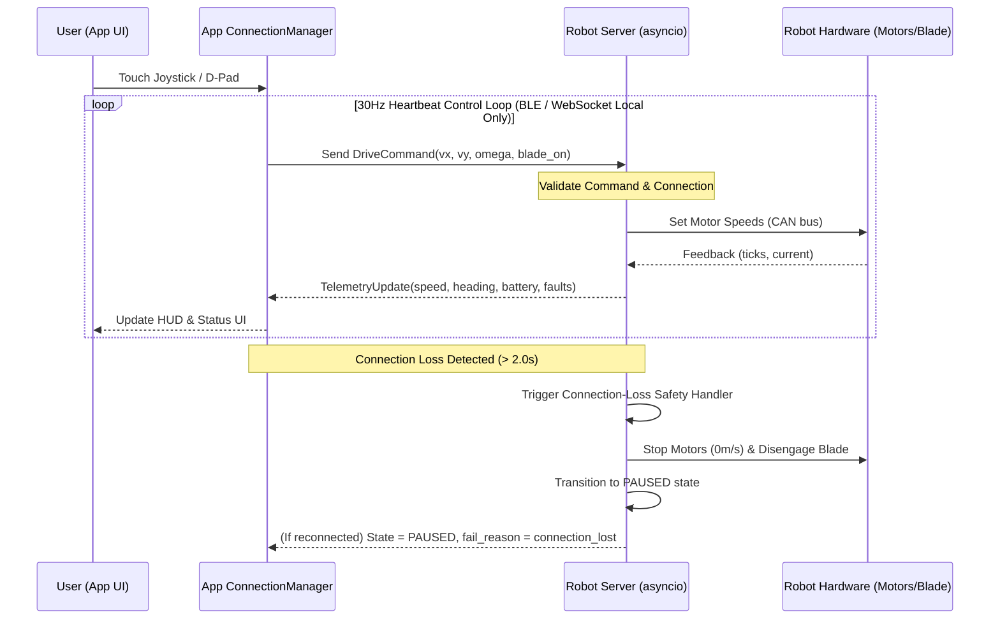
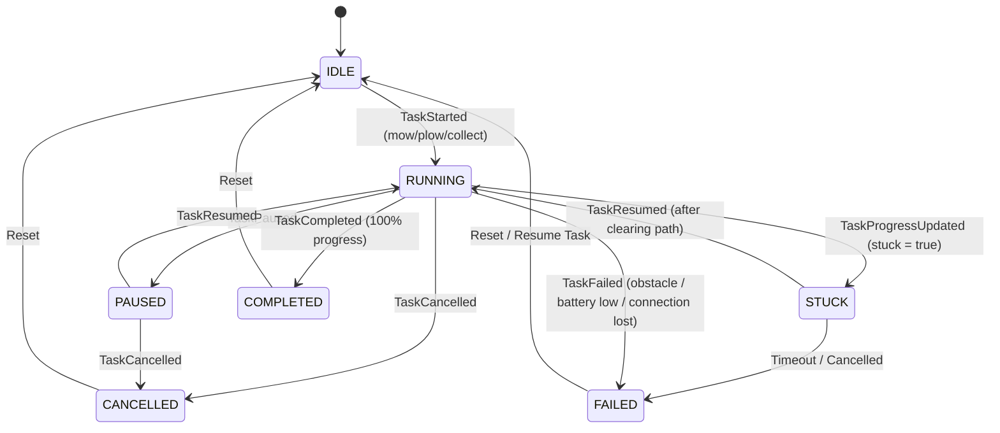

# ChoreRobotics State Machine & Maneuvering Specification

This document provides a detailed specification of the state machines that control the **ChoreRobotics Robot** and the **ChoreRobotics Companion Application**, including how they interact during manual and autonomous maneuvering.

---

## 1. Overview of State Domains

State management is synchronized across three distinct layers:
1. **Robot Operational State**: Governs the physical robot's behavior, safety status, and low-level control.
2. **BLE Pairing & Onboarding**: Manages the secure authentication process when registering a new robot.
3. **App Connection Mode**: Determines the active communication channel (BLE, WiFi, or Cloud) based on latency and availability.
4. **App Task State**: Mirrors the robot's active task execution in the Flutter interface (BLoC state).

---

## 2. Robot Operational State Machine

The robot's physical controller runs a central state machine that determines what commands it can accept and how it behaves in safety-critical situations.

### State Definitions

| State | Description | Safety-Critical Actions | Allowed Transitions |
|---|---|---|---|
| **IDLE** | The robot is active, stationery, and waiting for commands. | Drive motors locked (0 m/s), Blades **OFF**. | `WORKING`, `DOCKED`, `ESTOP`, `ERROR` |
| **WORKING** | The robot is actively maneuvering, either autonomously executing a task or driven manually. | Drive motors active, Blades/Attachments **ON** (if configured). | `IDLE`, `PAUSED`, `ESTOP`, `ERROR` |
| **PAUSED** | An active task is suspended. The robot remembers its path progress and can resume. | Drive motors stopped, Blades immediately **OFF**. | `WORKING`, `IDLE`, `ESTOP` |
| **DOCKED** | The robot is situated in its charging dock. | Drive motors disabled, Blades **OFF**. | `CHARGING`, `IDLE`, `ESTOP` |
| **CHARGING** | The battery pack is actively receiving power from the dock. | Drive motors disabled, Blades **OFF**. | `DOCKED`, `ESTOP`, `ERROR` |
| **ERROR** | A non-critical sensor or hardware fault is active. Manual inspection may be required. | Drive motors disabled, Blades **OFF**. | `IDLE`, `ESTOP` |
| **ESTOP** | **Emergency Stop Engaged.** Hardware power to motors and blades is cut. | Relay cut (safe-state), Blades immediately **OFF**. | `IDLE` (Manual release only) |

---

## 3. Onboarding & BLE Pairing State Machine

ペアリング (pairing) sequence handles the transition from discovery to mTLS secure connection setup. The pairing phases directly control the LED states of the robot.

---

## 4. App Connection & Auto-Switching State Machine

The companion application automatically handles connection transitions based on latency and network availability.

---

## 5. Maneuvering Interaction Loop (Manual Drive)

When maneuvering the robot manually via the app (Joystick or D-Pad), low-latency control is protected by a continuous safety loop.

### Safety Features in Maneuvering:
1. **Local connection restriction**: Manual controls (especially blade engagement) are strictly forbidden over cloud connections (`CLOUD_CONNECTED`) and require local BLE or LAN WiFi connections to minimize latency-induced hazards.
2. **30Hz Keepalive Heartbeat**: If a manual drive command is not received for **2.0 seconds**, the robot automatically stops drive motors and halts the blade.
3. **Hardwired E-Stop Override**: Emergency stop triggers bypass the application layer, communicating directly to cut power relays to the motor drivers.

---

## 6. App Active Task State Machine

The Flutter application mirrors the task state through the `ActiveTaskBloc` to show overlay notifications and progress updates.

---

## 7. State Transition Matrix

The table below outlines the core operational transitions triggered by events across the robot and app.

| Source State | Event | Target State | Guard Conditions | Actions / Output |
|---|---|---|---|---|
| **IDLE** | `START_TASK` (App Command) | **WORKING** | Robot paired, GPS RTK has Fix, no active E-Stop. | Start blades, activate autonomous navigation. |
| **IDLE** | `MANUAL_DRIVE` (App Control) | **WORKING** | Connection type is local (`BLE` or `WEBSOCKET`). | Accept 30Hz drive vectors. |
| **WORKING** | `PAUSE` (App Command / Obstacle) | **PAUSED** | None. | Stop motors, shut down blade. Save task position. |
| **WORKING** | `CONNECTION_LOSS` (>2.0s) | **PAUSED** | Communication heartbeat fails. | Stop motors, shut down blade. Log connection_lost. |
| **PAUSED** | `RESUME_TASK` (App Command) | **WORKING** | Connection re-established, path is clear. | Start blades, resume autonomous navigation. |
| **PAUSED** | `CANCEL_TASK` (App Command) | **IDLE** | None. | Reset task parameters, clear active task overlay. |
| **WORKING** | `TASK_COMPLETED` (Auton.) | **IDLE** | Progress reached 100%. | Stop blades, return to dock or wait for command. |
| **ANY** | `E_STOP` (App / Hardware Button) | **ESTOP** | None. | Cut power relay. Stop blades/motors. Mark task failed. |
| **ESTOP** | `CLEAR_E_STOP` (App Command) | **IDLE** | Hardware switch released, system diagnostics clear. | Restore power relay. Initialize sensors. |
| **WORKING** | `CRITICAL_FAULT` (Hardware) | **ERROR** | Sensor or motor failure detected. | Stop drive and blades immediately. Emit alert to app. |
