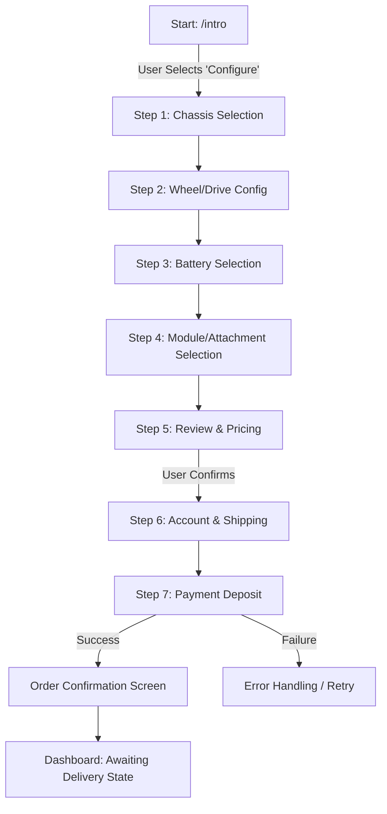

# Functional Requirements: Robot Reservation Flow

**Version:** 1.1 (Design Aligned)
**Date:** 2026-01-10
**Design Compliance:** Must strictly adhere to `design_document.md` (Dark Industrial Cyberpunk).

## 1. Overview
The **Robot Reservation Flow** ("Book My Robot") is the primary acquisition funnel. It allows users to customize their Chore Robot using a high-fidelity, cinematic interface that reflects the "Dark Industrial Cyberpunk" aesthetic.

## 2. User Flow Diagram



## 3. Functional & Visual Requirements by Step

### General Design Specs
*   **Background:** Deepest Blue-Black (`#03070C`) with orbital glows.
*   **Typography:** `Poppins` for headings, `Inter` for UI text.
*   **Cards:** "Bento Grid" style (`rgba(255, 255, 255, 0.03)`).

### Step 1: Chassis Selection
*   **Goal:** User selects the base model color/finish.
*   **Visual Style:**
    *   **Hero:** "High-Fidelity Wireframe" or Dark Studio render of the chassis in center.
    *   **Controls:** Floating "Glass Buttons" for color selection.
*   **Requirements:**
    *   Display high-fidelity 3D render, rotatable.
    *   **Selection:** Options presented in a minimal, suspended glass pane.
    *   **Logic:** Updates `chassis_color`. 3D model reflects material change (e.g., Matte Black vs. Cyber Silver).

### Step 2: Wheel/Drive Configuration
*   **Goal:** Select mobility type.
*   **Visual Style:**
    *   **Layout:** "Bento Grid" cards for the two options.
    *   **Selected State:** Active card highlights with `1px` gradient border (`--gradient-brand`).
*   **Options:**
    *   **Standard Wheels:** Icon + "Pavment/Lawn" descriptor.
    *   **All-Terrain Treads:** Icon + "Snow/Rough" descriptor + Pricing Surcharge.
*   **Logic:** Toggling "Treads" updates the 3D model's lower half instantly.

### Step 3: Battery Selection
*   **Goal:** Select range.
*   **Visual Style:**
    *   **Visualization:** Digital holographic gauge or glowing bar overlay near the battery pack on the 3D model.
    *   **Selector:** Slide or Toggle with Neon Cyan accents.
*   **Options:**
    *   **Standard (75kWh):** ~4 hours.
    *   **Long Range (100kWh):** ~8 hours (Premium).
*   **Logic:** Updates price and "Estimated Range" metric shown in `display-text` style.

### Step 4: Module/Attachment Selection
*   **Goal:** Select active attachments.
*   **Visual Style:**
    *   **List:** "Vertical Module Specs" layout (Unrolled).
    *   **Items:** Each module is a card with a schematic/wireframe thumbnail.
*   **Requirements:**
    *   Multi-select enabled.
    *   **Visual Feedback:** Selecting a module (e.g., "Snow Blower") attaches it to the 3D model in a "assembling" animation or shows a ghosted overlay.
*   **Modules:** Mower Deck, Snow Blower v2, Leaf Blower, Security Array.

### Step 5: Review & Pricing
*   **Goal:** Final summary.
*   **Visual Style:**
    *   **Invoice:** A sleek, semi-transparent "Glass" slate.
    *   **Typography:** Final Price in large `display-text` with Brand Gradient fill.
    *   **Button:** Primary CTA "Reserve Now" using **Gradient Button** style (`--gradient-brand` background + Glow).
*   **Requirements:**
    *   Line item breakdown.
    *   Deposit amount clearly visible.

### Step 6: Account & Shipping
*   **Goal:** User details.
*   **Visual Style:**
    *   **Forms:** Input fields with dark backgrounds (`rgba(255,255,255,0.05)`) and bottom borders only (minimalist).
    *   **Focus:** Input focus triggers a gradient border line.

### Step 7: Payment Deposit
*   **Goal:** Secure reservation.
*   **Visual Style:**
    *   Standard secure payment elements wrapped in the application's dark theme styling.

### Step 8: Order Confirmation
*   **Goal:** Success state.
*   **Visual Style:**
    *   **Animation:** Large "Success" checkmark or orbital animation using Brand Gradient colors.
    *   **Hero:** The fully configured robot spins slowly with "Cyberpunk" rim lighting.
    *   **Action:** "Enter Command Center" (Dashboard) button.

## 4. API Data Contract (Draft)

### Submit Reservation
**Endpoint:** `POST /orders/reserve`

**Request Body:**
```json
{
  "configuration": {
    "chassis": "matte_black",
    "drive_train": "treads",
    "battery": "100kwh",
    "modules": ["snow_blower", "security_cam"]
  },
  "shipping_address": {
    "street": "123 Robot Lane",
    "city": "Future City",
    "zip": "90210",
    "country": "USA"
  },
  "payment_token": "tok_visa_..."
}
```

**Response (200 OK):**
```json
{
  "order_id": "ORD-555-01",
  "status": "reserved",
  "delivery_estimate": "2026-05-01"
}
```

## 5. Error Handling
*   **Visuals:** Error states use "Safety Orange" (`#FF3D00`) borders or glowing text.
*   **Payment Failure:** Shake animation on the payment card.
